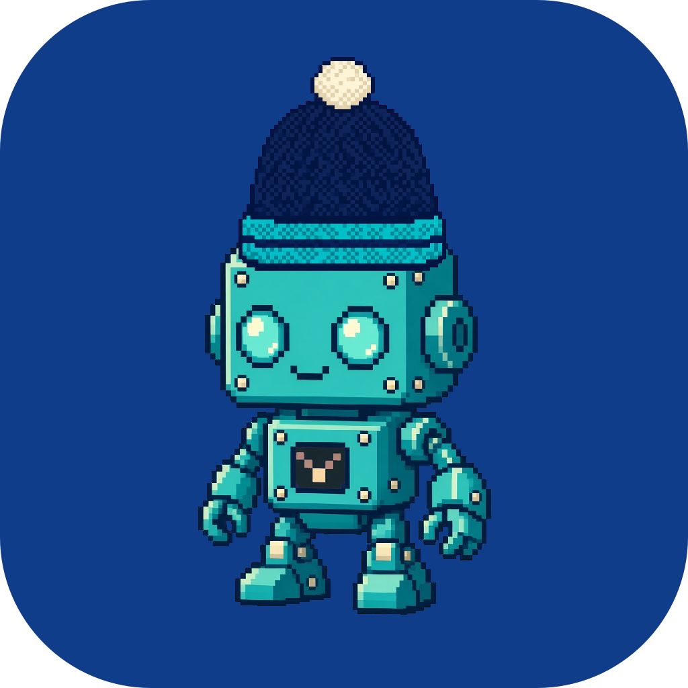

# Pocket Pixels

A pixel-art NFT collection built from layered PNG traits. Each token is a
background pane with a character composited on top.

## Starting example

The first character is the CCLU squid: a side-profile pixel-art squid,
turquoise `#2EE6D6` with cream suckers. The first background is its flat blue
plate `#0F3D8A`, no glow. Together they are the CCLU app icon.


## Layout

| Path                       | What it is                                             |
| -------------------------- | ------------------------------------------------------ |
| `layers/background/*.png`  | Background panes, 1024x1024, rounded plate with alpha. |
| `layers/character/*.png`   | Characters on transparent backgrounds.                 |
| `layers/hat/*.png`         | Hats, tight-cropped so the bottom edge is the brim.    |
| `layers/layers.json`       | Layer order, trait names, character scale.             |
| `scripts/compose.mjs`      | Composites a character onto a background into `out/`.  |
| `scripts/generate.mjs`     | Builds the collection: weighted draws, PNG + metadata. |
| `scripts/recolor.mjs`      | Makes a colour variant of a character by hue remap.    |
| `scripts/defringe.mjs`     | Removes white matte fringe, hardens a character's edge.|
| `scripts/cutout.mjs`       | Keys a flat-colour background out of a drawn character. |
| `scripts/anchors.mjs`      | Debug sheet: every character with its anchors drawn.   |
| `scripts/lib/compose.mjs`  | Shared renderer used by both scripts.                  |
| `site/`                    | Home page: gallery, builder, layer info, collection.   |
| `examples/`                | Reference renders checked in for the README.           |

## Backgrounds

| Trait           | Look                                                   |
| --------------- | ------------------------------------------------------ |
| `ink-blue`      | Flat `#0F3D8A` plate. The official one.                |
| `ink-glow-soft` | Dark ink navy, soft turquoise glow lower right.        |
| `ink-glow-grid` | Dark ink navy, turquoise glow, faint pixel grid.       |

## Home page

```sh
npm run dev        # http://127.0.0.1:4610  (PORT overrides)
```

A single dark page served by `site/server.mjs`: the example renders, a live
trait builder that uses the same compositor as the generator, every layer
and trait with its weight, odds and file, and the last generated collection
with a Generate button. All URLs are relative, so it also works behind the
CCLU preview proxy.

## Render

```sh
npm install
npm run compose                      # squid on ink-blue -> out/
npm run compose -- squid ink-glow-grid
npm run compose -- robot ink-blue beanie
npm run compose:all                  # every background x character, plus every hat on ink-blue
```

## Generate the collection

```sh
npm run generate                                # every unique combo, seed 1
npm run generate -- --count 500 --seed 42       # N unique tokens, reproducible
npm run generate -- --image-base ipfs://<CID>   # metadata "image" points at IPFS
```

Writes to `build/` (gitignored):

| Path                       | What it is                                             |
| -------------------------- | ------------------------------------------------------ |
| `build/images/<id>.png`    | One 1024x1024 render per token.                        |
| `build/metadata/<id>.json` | XLS-24 style metadata: name, image, attributes.        |
| `build/collection.json`    | Seed, every token's traits, and rarity counts.         |

Trait rarity lives in `layers/layers.json` as a `weight` per trait (relative,
any scale). Draws are seeded and deduplicated, so the same seed always yields
the same collection. `--count` is capped at the number of unique combos.

### Adding a trait

1. Drop a 1024x1024 transparent PNG at `layers/<layer>/<trait>.png`.
2. Add `"<trait>": { "name": "Display Name", "weight": 10 }` to that layer in
   `layers/layers.json`.
3. `npm run compose -- <character> <background>` to eyeball it.

New layers (hats, eyes, held items) go in `order` bottom to top with
`"fit": "contain"` and a `scale`.

### New character from a drawing

```sh
cclu draw --engine grok --ar 1:1 "<pixel-art character> ... flat solid magenta #FF00FF background"
node scripts/cutout.mjs <image> <trait>     # key out the background, crop, square
node scripts/defringe.mjs <trait>           # always
```

Then give it anchors (below) and a weight in `layers/layers.json`.

### Anchors: accessories that fit every character

Each character trait carries `anchors` in its own image pixels, e.g.
`"hat": { "x": 578, "y": 150, "w": 360 }`: the centre and width of where a hat
brim sits. An accessory layer declares

```json
"hat": { "fit": "anchor", "anchor": "hat", "on": "character", "widthScale": 1.15, "overlap": 0.15,
         "traits": { "none": { "name": "None", "weight": 70 }, "beanie": { "name": "Beanie", "weight": 30 } } }
```

and the compositor scales it to the host's anchor width and sets its bottom
edge on the anchor line, so one hat PNG fits the squid and the robot alike.
The trait key `none` means the layer is absent. `node scripts/anchors.mjs`
renders `out/anchors.png` to eyeball the anchors on every character.

### Clean edges

```sh
node scripts/defringe.mjs <trait>   # drop faint edge pixels, snap the rest to a solid neighbour
```

Run this once on any character cut out from a white background; otherwise a
pale rim shows on dark plates. Pixel art has no anti-aliasing, so the edge
should be hard.

### Colour variants

```sh
node scripts/recolor.mjs squid squid-gold --hue 45 --light 1.14   # shift the accent hue
node scripts/recolor.mjs squid squid-grey --sat 0.05 --light 1.05  # desaturate
```

Only pixels in the source's accent hue band (`--range`, default 150-205 for
the turquoise squid) change, so eyes, suckers and outlines stay put.

## Characters

| Trait        | Weight | Look                                   |
| ------------ | ------ | -------------------------------------- |
| `squid`      | 45     | The original turquoise `#2EE6D6` squid. |
| `squid-grey` | 15     | Desaturated slate grey.                |
| `squid-gold` | 10     | Warm gold, the rare one.               |
| `robot`      | 30     | Boxy turquoise robot, same palette.    |

## Hats

| Trait    | Weight | Look                                            |
| -------- | ------ | ----------------------------------------------- |
| `none`   | 60     | No hat.                                         |
| `beanie` | 40     | Navy knit beanie, turquoise brim stripe, cream pom. |

Hats sit on each character's `hat` anchor (width ×1.1, sunk 28% of their
height), so the same PNG fits the squid's mantle and the robot's head. An
anchor can override the fit per character: `rotate` (degrees, clockwise; the
squid's is 22 so hats lean back with the mantle), `scale` (the robot's is 0.8
so hats stay in proportion to its boxy head) and `overlap`. Rotation samples
nearest-neighbour, so edges stay hard.
Characters are drawn at 72% of the canvas and nudged down 6% to leave headroom.




## Style rules

Dark, premium, restrained. Crisp square pixels, nearest-neighbour scaling, one
accent colour per piece. No busy backgrounds, no gloss, no clip-art.
